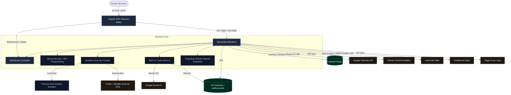

# 🎮 Student Skill Tracker

> A state-of-the-art, gamified competitive programming, cognitive profiling, and AI-driven mentorship platform.

The **Student Skill Tracker** is a full-stack platform designed to help students master software engineering and algorithmic skills. By integrating third-party platforms (GitHub, LeetCode, Codeforces), utilizing process-isolated execution sandboxes, offering a real-time multiplayer Duel Arena, and deploying a persistent AI mentor ("Rishi") protected by multi-layer guardrails, this application gamifies education while maintaining top-tier enterprise security standards.

---

## 🏛️ System Architecture

The platform uses a decoupled client-server architecture with real-time bidirectional communication channels.



---

## ✨ Core Features

### 1. ⚔️ Multiplayer Duel Arena (`/duel-arena`)
* **Real-time Matchmaking**: Synchronous matchmaking for head-to-head coding duels.
* **WebSocket Syncing**: Leverages STOMP over SockJS for instant state syncing, code updates, and duel telemetry.
* **Smart Problem Routing**: Automatically recommends balanced questions based on mutual player weaknesses and historical skill levels.

### 2. 💻 Battle Station Compiler (`/battle-station`)
* **Multi-Language Support**: Compile and run Java, Python, C++, and JavaScript code.
* **Hybrid Execution**: Runs code locally using strict system process-level sandbox parameters or offloads code execution to external secure sandboxes (Piston/JDoodle).
* **Resource Optimization**: Implements strict memory constraints (`-Xmx128m` for Java runs) and execution timeouts (`Process.waitFor(timeout, unit)`) to eliminate resource starvation and infinite loop DoS vectors.

### 3. 🧠 Cognitive Sprints & EQ Assessments (`/cognitive-sprint`)
* **Interactive Testing**: Features logical reasoning, visual attention, and short-term working memory sprints.
* **Psychological Benchmarking**: Incorporates EQ assessments to map student stress-handling and persistence capabilities.
* **Tailored Pathing**: Saves cognitive profiles in the database to adjust question recommendations and AI counseling styles.

### 4. 📈 Forgetting Velocity Engine
* **Spaced Repetition Decay**: Tracks specific skill decay based on the time elapsed since the student last solved a problem in that domain.
* **Visual Warnings**: Alerts students when their mastery in critical areas (e.g., Graphs, Dynamic Programming) is declining.

### 5. 🤖 Rishi AI Coach (`/advisor`)
* **Career Counselor**: Custom resume evaluation and job matching alignment using Google's Gemini LLM.
* **Smart Study Schedulers**: Generates customized study calendars and syncs them automatically to the student's Google Calendar.
* **Short & Long-Term Memory**: Utilizes database-backed memory buffers to persist coaching history and reference past performance details.

### 6. 🎒 The Arsenal Integration Hub (`/arsenal`)
* **Google Calendar OAuth**: Sync study sessions directly.
* **Toggl Focus Logs**: Sync Pomodoro or focus sessions to log study hours.
* **Profile Aggregation**: Synchronize LeetCode (problems solved), Codeforces (ratings), and GitHub (contributions) stats.

---

## 🔒 Security Hardening & OWASP Compliance

For complete details, see [security_audit.md](file:///C:/Users/Savyasachi%20Mishra/Desktop/student-skill-tracker/security_audit.md).

* **Argon2id Password Hashing**: Replaced BCrypt with Argon2id (BouncyCastle) to secure passwords against high-throughput GPU/ASIC brute-force cracking.
* **7-Layer Prompt Injection Defense**: Protects Rishi AI with systemic boundaries:
  1. *Persona Anchoring*: Hardcoded system identity definitions.
  2. *OWASP Guardrails*: Custom validation instructions.
  3. *Structural Isolation*: Inputs encapsulated in strict XML tags.
  4. *Context Delimiting*: Clear demarcation rules.
  5. *Encoding Neutralization*: Processing encoded payloads as pure raw strings.
  6. *Hypothetical Defense*: Rejects conditional bypass requests.
  7. *Adversarial Hardening*: Screens input strings for prompt injection tokens.
* **Insecure Direct Object Reference (IDOR)**: Enforces `@PreAuthorize` ownership validation (`isOwner()`) at the API gateway layer to prevent students from querying/manipulating other users' datasets.
* **Brute-Force Lockout**: Integrated `LoginAttemptService` blocklist which locks down client IP addresses for 15 minutes after 5 consecutive authorization failures.
* **Stateless JWT Multi-Fingerprinting**: Embeds user-agent hashes (`uah`) and HttpOnly cookie-bound client fingerprints (`fgp`) inside signed JWT claims, rendering stolen tokens mathematically invalid on unauthorized browsers.
* **Remote Code Execution (RCE) Defense**: Analyzes uploaded source code against blacklisted API footprints (`Runtime.getRuntime`, `ProcessBuilder`, `reflect`, `os.system`) before execution, alongside process-isolated custom OS environments.

---

## 🛠️ Technical Stack

### Backend
* **Runtime**: Java 21 (uses Virtual Threads `spring.threads.virtual.enabled=true` for maximum throughput)
* **Framework**: Spring Boot 3.4.11 (MVC, Data JPA, WebSockets, Security)
* **Database**: H2 Database (File-backed storage via `skilltrackerdb`)
* **Caching**: Upstash Redis (strict SSL configuration)
* **AI Engine**: Gemini API Integration
* **Security Providers**: Spring Security, BouncyCastle (Argon2id)

### Frontend
* **Runtime**: Node.js & npm
* **Framework**: Angular 21.1.2 (Standalone architecture, SSR support)
* **State Management**: `@ngrx/signals`
* **Text Editor**: Monaco Code Editor (`ngx-monaco-editor-v2`)
* **Styling**: TailwindCSS 4 (Utility-first styling with modern postcss integration)
* **WebSocket Client**: `@stomp/stompjs` & `sockjs-client`

---

## 🚀 Local Setup & Installation

### Prerequisites
* **Java**: JDK 21 installed and added to `PATH`
* **Node.js**: Node.js (v20+) installed and added to `PATH`
* **Maven**: Maven wrapper `mvnw` is included in the project root. Alternatively, you can use a globally installed Maven instance.

### Configuration
Open [application.properties](file:///C:/Users/Savyasachi%20Mishra/Desktop/student-skill-tracker/src/main/resources/application.properties) and update variables as needed. By default, it runs with:
* Database: File-based H2 database (`./skilltrackerdb`)
* Server Port: `8082`
* Caching: In-memory (`simple`) by default, Upstash Redis when `SPRING_CACHE_TYPE=redis`

### Building & Executing

#### 1. Setup the Frontend
Run the setup script to install dependencies and configure Angular settings:
```powershell
# Using PowerShell
.\setup.ps1

# Using Command Prompt (runs setup.bat)
setup.bat
```

#### 2. Start the Backend
Compile and launch the Spring Boot service:
```bash
# Clean and run the application
rebuild_backend.bat
```
The server will start on [http://localhost:8082](http://localhost:8082). You can verify health via [http://localhost:8082/api/ping](http://localhost:8082/api/ping).

#### 3. Start the Frontend
Navigate into the frontend directory and launch the Angular development server:
```bash
cd frontend
npm install
npm run start
```
The application will launch on [http://localhost:4200](http://localhost:4200).

---

## 📂 Project Directory Structure

```text
student-skill-tracker/
├── .github/                       # GitHub workflow and issue templates
├── .vscode/                       # Shared VS Code configurations
├── conductor/                     # Project investigation workspace
│   └── investigation_plan.md      # Codebase module research guidelines
├── frontend/                      # Angular 21 Standalone application
│   ├── src/
│   │   ├── app/                   # App routing, components, and layout
│   │   │   ├── advisor/           # AI Coach (Rishi) UI
│   │   │   ├── arsenal/           # Integration configuration page
│   │   │   ├── battle-station/    # Sandboxed IDE (Monaco Editor)
│   │   │   ├── cognitive-sprint/  # Attention, Logic, Memory tests
│   │   │   ├── core/              # Global guards, services, and interceptors
│   │   │   ├── dashboard/         # Main statistics and level overview
│   │   │   ├── duel-arena/        # Competitive coding multiplayer portal
│   │   │   └── settings/          # Security credentials & configuration
│   │   └── main.ts
│   ├── package.json               # Frontend dependencies & build commands
│   └── tailwind.config.js.bak     # Tailwind CSS configuration backup
├── src/                           # Spring Boot backend source files
│   ├── main/
│   │   ├── java/com/skilltracker/student_skill_tracker/
│   │   │   ├── compiler/          # Local sandboxed executors & compile controllers
│   │   │   ├── config/            # WebSecurity, WebSocket STOMP, Async, & Redis Configs
│   │   │   ├── controller/        # REST APIs (Student, Advisor, Duel, Compiler, etc.)
│   │   │   ├── dto/               # REST Request/Response Data Transfer Objects
│   │   │   ├── model/             # JPA entity definitions (Student, Skill, Match, etc.)
│   │   │   ├── repository/        # Spring Data JPA Repository definitions
│   │   │   ├── security/          # JWT signature and request validation filters
│   │   │   ├── service/           # Core business logic (Rishi AI, Duels, Compilers)
│   │   │   └── util/              # Utilities (Argon2id helpers, SkillCalculators)
│   │   └── resources/
│   │       ├── application.properties  # Main server configurations
│   │       ├── advice_content.json      # Hardcoded advisor data templates
│   │       └── common_questions.json    # Default problem sets for coding arena
│   └── test/                      # JUnit and Integration test suites
├── Dockerfile                     # Multi-stage production build script
├── pom.xml                        # Maven configuration
├── render.yaml                    # Cloud deployment orchestration mapping
├── rebuild_backend.bat            # Script to kill and rebuild Spring Boot backend
└── security_audit.md              # OWASP defense architecture summary
```
